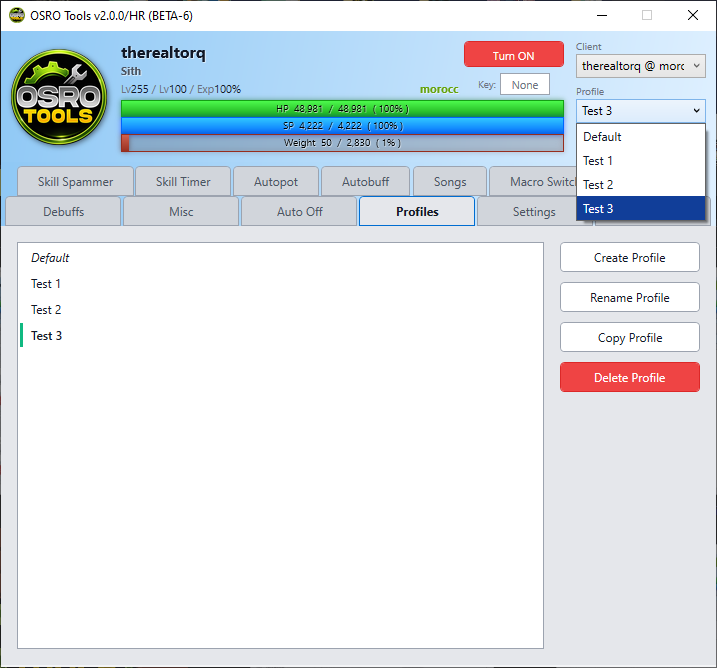

# Profiles

The **Profiles** tab helps you manage all your saved setups. You can create different profiles for different characters or game modes and switch between them at any time.

## 1. Managing Profiles
1. Open the **Profiles** tab in OSRO Tools.
2. Click **Create Profile** to make a new profile, or **Copy Profile** to duplicate the selected one.
3. Double-click any profile in the list to load it.
4. Use **Import Profile** and **Export Profile** (or drag and drop `.json` files onto the list) to share profiles with friends.
5. Click **Delete Profile** to remove a profile you no longer need.

## 2. Quick Switching & Auto-Switch
You can switch profiles without opening the **Profiles** tab:
* **Switch Hotkey:** Select a profile and press a key (or `Ctrl` / `Alt` / `Shift` + key) in **Switch Hotkey** to load that profile from inside the game.
* **Linked Characters:** Click **+ Link Char** and enter your character name. When **Auto-switch by character** is checked, OSRO Tools automatically loads that profile whenever you log onto that character.
* **System Tray:** Right-click the OSRO Tools icon in the Windows system tray and choose a profile from **Profiles**.

## 3. Tips
* Press `Esc` or `Backspace` inside the **Switch Hotkey** box to clear an assigned shortcut.
* Click the keyboard icon on the top header to open **Keybind Overview** and review every hotkey in your active profile.

